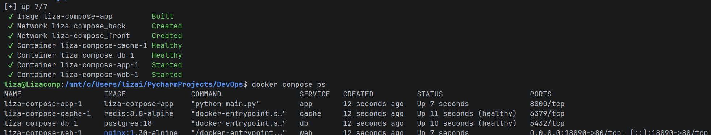
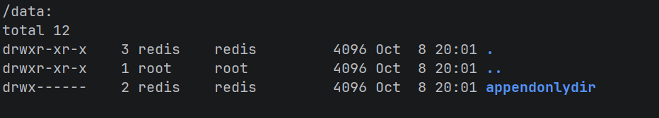
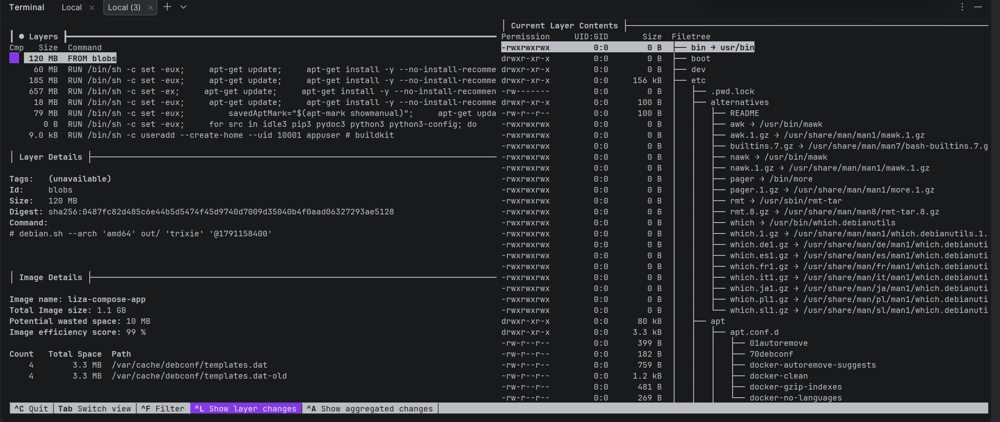
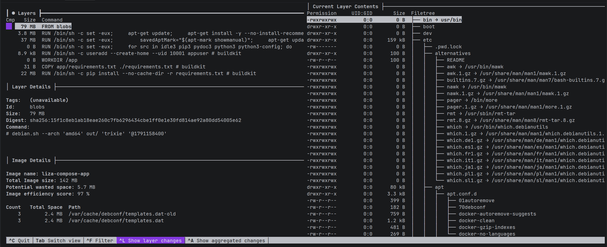

Вторая домашка по DevOps 

## 1.Продолжите Flask-приложение

```docker compose up -d --build```



Обращение к app:

```
liza@Lizacomp:/mnt/c/Users/lizai/PycharmProjects/DevOps$ curl -i http://localhost:18090/
HTTP/1.1 200 OK
Server: nginx/1.30.5
Date: Thu, 08 Oct 2026 19:04:26 GMT
Content-Type: text/plain; charset=utf-8
Content-Length: 32
Connection: keep-alive

Docker Compose demo - visits: 1
```
## 2. 

после смены БД осталась контрольная заметка

```commandline
liza@Lizacomp:/mnt/c/Users/lizai/PycharmProjects/DevOps$ docker compose exec db bash
root@d4e79b696057:/# psql -U $POSTGRES_USER -d $POSTGRES_DB
psql (18.6 (Debian 18.6-1.pgdg13+2))
Type "help" for help.

flask=# SELECT * FROM notes;
 id |   text    
----+-----------
  1 | i_am_here
(1 row)
```

А вот Redis не сохранился. Если пропишем redis.conf, поменяем volume и допишем в конце volumes, тогда все сохраняется



## 3.
```commandline
docker compose down
docker run --rm -v liza-compose_pgdata:/volume -v $(pwd):/backup alpine tar czf /backup/pg_data.tar.gz -C /volume .
docker run --rm -v liza-compose_pgdata:/volume -v "$(pwd)":/backup alpine \
  sh -c "cd /volume && tar xzf /backup/pg_data.tar.gz"
docker compose up -d
liza@Lizacomp:/mnt/c/Users/lizai/PycharmProjects/DevOps$ docker compose exec db bash
root@581c4b9c18da:/# psql -U "$POSTGRES_USER" -d "$POSTGRES_DB"
psql (18.6 (Debian 18.6-1.pgdg13+2))
Type "help" for help.

flask=# SELECT * FROM notes;
 id |   text    
----+-----------
  1 | i_am_here
(1 row)
```

т.е. заметка сохранилась

## 4.

Web часть не смогла пройти по db
```commandline
/ # nslookup db
Server:         127.0.0.11
Address:        127.0.0.11:53

;; connection timed out; no servers could be reached
```

```commandline
curl -i http://172.18.04:8000/notes

liza@Lizacomp:/mnt/c/Users/lizai/PycharmProjects/DevOps$ docker compose logs app
app-1  |  * Serving Flask app 'main'
app-1  |  * Debug mode: off
app-1  | WARNING: This is a development server. Do not use it in a production deployment. Use a production WSGI server instead.
app-1  |  * Running on all addresses (0.0.0.0)
app-1  |  * Running on http://127.0.0.1:8000
app-1  |  * Running on http://172.18.0.4:8000
app-1  | Press CTRL+C to quit
app-1  | 172.19.0.3 - - [08/Oct/2026 20:31:17] "GET /notes HTTP/1.1" 200 -
app-1  | 172.19.0.3 - - [08/Oct/2026 20:47:20] "GET /notes HTTP/1.1" 200 -
```

т.е. проходит до db


web делает запрос в flask, так как docker изолировал эти компоненты,  flask делает подключение по IP, которое ему выдал docker


## 5.

проект liza-compose, потому что это мой
есть главное приложение, есть кэш, который сохраняется с помощью volume, db  такое же, приложение запускается только при запуске cache и db
```commandline
liza@Lizacomp:/mnt/c/Users/lizai/PycharmProjects/DevOps$ docker compose config
name: liza-compose
services:
  app:
    build:
      context: /mnt/c/Users/lizai/PycharmProjects/DevOps
      dockerfile: Dockerfile
    depends_on:
      cache:
        condition: service_healthy
        required: true
      db:
        condition: service_healthy
        required: true
    environment:
      DB_HOST: 
      POSTGRES_DB: 
      POSTGRES_PASSWORD: 
      POSTGRES_USER: 
      REDIS_HOST: 
    mem_limit: "268435456"
    networks:
      back: null
      front: null
    restart: unless-stopped
  cache:
    command:
      - redis-server
      - /usr/local/etc/redis/redis.conf
    healthcheck:
      test:
        - CMD
        - redis-cli
        - ping
      timeout: 2s
      interval: 2s
      retries: 15
    image: redis:8.8-alpine
    networks:
      back: null
    restart: unless-stopped
    volumes:
      - type: bind
        source: /mnt/c/Users/lizai/PycharmProjects/DevOps/redis/redis.conf
        target: /usr/local/etc/redis/redis.conf
        read_only: true
        bind: {}
      - type: volume
        source: redis
        target: /data
        volume: {}
  db:
    environment:
      POSTGRES_DB: 
      POSTGRES_PASSWORD: 
      POSTGRES_USER: 
    healthcheck:
      test:
        - CMD-SHELL
        - pg_isready -U $$POSTGRES_USER -d $$POSTGRES_DB
      timeout: 2s
      interval: 2s
      retries: 15
      start_period: 3s
    image: postgres:18
    networks:
      back: null
    restart: unless-stopped
    volumes:
      - type: volume
        source: pgdata
        target: /var/lib/postgresql
        volume: {}
  web:
    depends_on:
      app:
        condition: service_started
        required: true
    image: nginx:1.30-alpine
    networks:
      front: null
    ports:
      - mode: ingress
        target: 
        published: 
        protocol: tcp
    restart: unless-stopped
    volumes:
      - type: bind
        source: /mnt/c/Users/lizai/PycharmProjects/DevOps/nginx/default.conf
        target: /etc/nginx/conf.d/default.conf
        read_only: true
        bind: {}
networks:
  back:
    name: liza-compose_back
  front:
    name: liza-compose_front
volumes:
  pgdata:
    name: liza-compose_pgdata
  redis:
    name: liza-compose_redis
```

при команде down, данные не удаляются из временного архива, при down -v удаляются полностью

## 6.
Вообще, Dockerfile на протяжении всей работы не сильно менялся, единственное, что менялось это версия питона, которую я взяла. Я поменяла на python:3.14 вместо python:3.14-slim, чтобы поэкспериментировать



Нижний вариант - это если оставить python:3.14-slim



получаем результат лучше